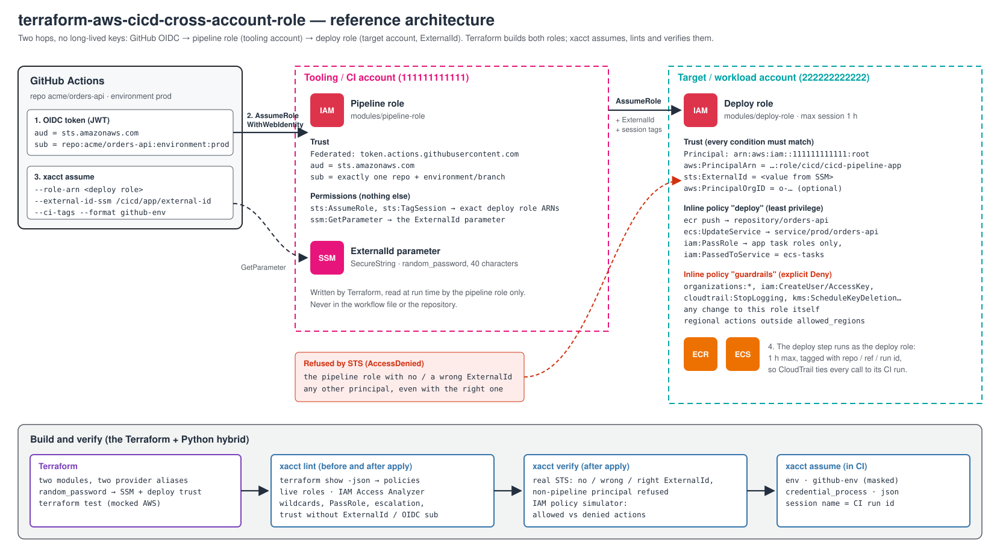
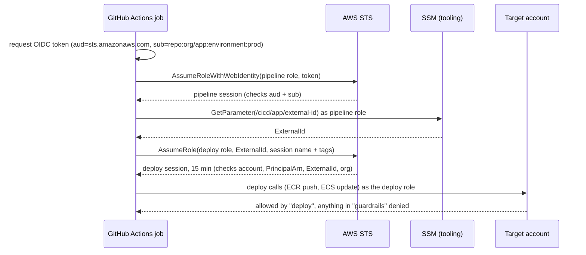
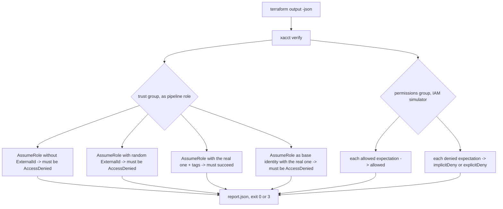

# Build guide: what gets built first, and why

This guide covers the project in two orders:

1. **Authoring order**: how to write this repository from scratch.
2. **Provisioning and run order**: what gets created in which account, and
   what happens, call by call, when a pipeline deploys.

---

## 1. Authoring order (how to build the repository)

| Step | Files | What | Why it comes here |
|---|---|---|---|
| 0 | — | **Design on paper**: who assumes what, which account owns which role, where the ExternalId lives, what the pipeline must never be able to do | Getting a trust policy wrong gives an attacker every target account. The identity chain and the guardrails are decided before any code. |
| 1 | `.gitignore`, `versions.tf`, `pyproject.toml` | Skeleton | State, plans and `terraform output` contain the ExternalId: ignored **before** the first plan exists. |
| 2 | `modules/deploy-role/` | Target-side role: trust, deploy policy, guardrails | The deploy role holds the real power, so its trust and limits are the core of the task. |
| 3 | `modules/pipeline-role/` | Tooling-side role: OIDC/AWS trust, assume-only permissions | Depends only on knowing the deploy role ARNs (strings, not resources). |
| 4 | `modules/*/tests/` | `terraform test` with a mocked provider | Locks in trust conditions and input validation with no AWS account. |
| 5 | `src/xacct/policy.py`, `lint.py` | Policy normalizer and lint rules | Pure functions over JSON: the easiest part to test exhaustively. |
| 6 | `src/xacct/sts.py` | AssumeRole with ExternalId, session names/tags, output formats | What the pipeline actually runs. |
| 7 | `src/xacct/verify.py`, `cli.py` | Post-apply checks, CLI, exit codes | Built on 5 and 6. |
| 8 | `tests/` | moto + a fake STS/IAM that enforces trust | moto accepts any AssumeRole, so a fake is needed to prove refusals. |
| 9 | `examples/`, `e2e/aws/` | Multi-account example, real-AWS harness | Show the modules wired together the way a team would. |
| 10 | `.github/workflows/ci.yml` | Terraform + Python checks, policy lint on examples | Turns steps 2–9 into a gate for `main`. |
| 11 | `README.md`, `docs/` | Usage, security, diagram, this guide | Documents what was actually built, so it is written last. |
| 12 | — | Run `e2e/aws` in a real account: plan lint, apply, `xacct verify`, live lint, real S3/ECR calls, idempotent plan, destroy | Mocks do not enforce IAM. Only STS can prove that a wrong ExternalId is refused. Done 2026-10-20: 20/20 checks after fixing two bugs the run found (see decisions). |

### Key decisions made in step 0

| Decision | Choice | Reason |
|---|---|---|
| Who the pipeline is | GitHub OIDC → pipeline role; `trusted_principal_arns` for CI systems with an AWS identity | No long-lived keys. The `sub` claim pins one repository and environment/branch. |
| Two hops instead of OIDC in every account | One OIDC trust in the tooling account, plain AssumeRole into targets | Targets need no OIDC provider and no GitHub knowledge; adding an account means one deploy role, not another federation. |
| Deploy-role principal | Account root **plus** `aws:PrincipalArn` = exact role ARN | A role ARN as principal is stored as the role's unique ID: re-creating the pipeline role silently breaks the trust, and the role must exist first. The account + condition form has neither problem and is just as narrow. |
| ExternalId | `random_password` (40 chars) → SSM SecureString in the tooling account; the module requires >= 16 chars | A second, independent condition besides the principal pin. Never in a workflow file. Not treated as a secret by AWS, so it does not replace the other controls. |
| OIDC provider | Input (`provider_arn`), not created by the module | One per account, usually owned by the platform team; creating it in a reusable module would conflict across stacks. |
| Permissions shape | `policy_statements` objects, rendered as an inline policy | Reviewable in a PR, lives and dies with the role, cannot be attached elsewhere. Wildcard Allow actions are rejected by validation. |
| Guardrails | Separate inline policy of explicit Denies, on by default | A Deny wins over any Allow, so a permission added later by mistake still cannot disable CloudTrail, create IAM users or edit this role. |
| Region limit | Deny `NotAction` global services when `aws:RequestedRegion` not in the list | Blocks regional resources in unexpected regions without breaking IAM/STS/CloudFront calls, which are global. |
| Session tags in the trust | `sts:TagSession` in its own statement, pinned by `aws:PrincipalArn`, without the ExternalId condition | Found in the real run: STS evaluates `TagSession` separately and the `sts:ExternalId` key is not in its context, so one shared statement refuses every tagged AssumeRole. TagSession alone grants nothing. |
| Simulator context type | `string` for one value, `stringList` for several | Found in the real run: with `stringList` the key is multi-valued and plain `StringLike`/`StringNotEquals` conditions are skipped, which hid the region deny. |
| Session length | 1 h max on the role, 15 min default in `xacct assume` | A deploy rarely needs more; role chaining caps it at 1 h anyway. |
| Why Python as well | `assume` (outside GitHub Actions too, `credential_process`), `lint` (plan + live), `verify` (negative tests) | Terraform can declare the roles but cannot prove that STS refuses the wrong caller. |
| Lint vs Access Analyzer | Own rules + optional `ValidatePolicy` | Access Analyzer checks grammar and generic security warnings; the own rules know the CI/CD intent (ExternalId required, OIDC `sub`, PassRole, escalation). |
| Verify permissions | IAM policy simulator | Tests allowed **and** denied actions without touching resources. Limits: no SCPs, no resource policies, so the e2e also makes real S3 calls. |
| Test strategy | Mocked Terraform, moto, a fake STS/IAM, one real-account run | Each layer proves something the previous one cannot. |

---

## 2. Provisioning and run order

### What gets created, in which account

| Order | Account | Resource | Depends on |
|---|---|---|---|
| 1 | (Terraform) | `random_password.external_id` | — |
| 2 | Tooling | SSM SecureString with the ExternalId | 1 |
| 3 | Tooling | Pipeline role + `assume-deploy-roles` inline policy | deploy role ARN (string), SSM parameter ARN |
| 3 | Target | Deploy role + `deploy` and `guardrails` inline policies | pipeline role ARN (string), ExternalId |

Steps 3 run in parallel: each role only needs the other's ARN as a string
(computed from names), not the resource. This is what the account-principal +
`aws:PrincipalArn` trust form allows.

### A deploy, call by call

### After apply (verification)

